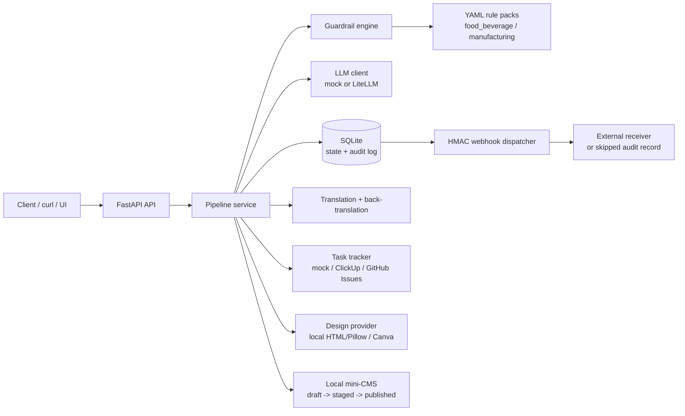
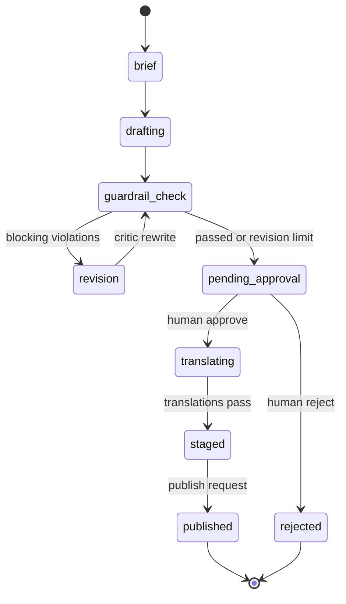

# Brand Content Agent Pipeline

An end-to-end content pipeline for a **fictional** brand: brief → grounded draft → guardrails → critic revision → human approval → translation with back-translation checks → staged → local CMS publish. Every state transition is persisted; when a webhook URL is configured, each transition is also emitted as an HMAC-signed webhook.

The default mode is deterministic **mock mode with zero API keys**. You can run the full workflow, tests, and eval harness without signing up for anything. Live mode adds Groq (primary), Gemini (automatic fallback), and optional Anthropic through LiteLLM.

> **Alder Grove is not a real company.** Every brand, product, fact sheet, and brief in this repository is invented for demonstration.

[](https://github.com/farheenfathimaa/brand-content-agent-pipeline/actions/workflows/ci.yml)

## The problem

Marketing content operations break in predictable places:

- A writer or model adds a health claim, spec, certification, or competitor product that the source material does not support.
- Brand voice rules live in a PDF, so they are enforced by review comments instead of automation.
- Compliance review and publishing happen in separate tools, leaving no reliable audit trail.
- Translation quality is assumed until a localized page goes live with a missing disclaimer.
- Evals are hand-waved, so nobody knows whether the latest prompt made things better or worse.

This project demonstrates a small, inspectable system that makes those failure modes explicit: deterministic guardrails, a bounded revision loop, a human approval gate, a second-language sanity check, and an eval harness that reports real numbers from the code in this repository.

## Architecture





`failed` is reachable from active states when a provider or staging step raises. Terminal states are `published`, `rejected`, and `failed`. Transitions are declared once in `app/state_machine.py` and enforced by the service layer.

## What is included

| Area | Implementation |
| --- | --- |
| API | FastAPI, OpenAPI docs at `/docs`, typed Pydantic request/response models |
| Persistence | SQLite with briefs, transition events, translations, CMS documents, and webhook delivery audit rows |
| State machine | Explicit allow-list of transitions, atomic state update + event append |
| LLM | Deterministic `MockLLM` by default; LiteLLM in live mode with manual provider fallback |
| Guardrails | YAML rule packs for `food_beverage` and `manufacturing`: banned claims, required disclaimers, brand voice, fact-sheet groundedness |
| Revision loop | Critic rewrite only for reported violations, capped by `MAX_REVISION_LOOPS` |
| Human gate | Approve, reject, or force-approve with a recorded override reason |
| Localization | Four languages, translation + back-translation, lexical similarity threshold, two attempts |
| Publishing | Local mini-CMS with draft → staged → published and HTML previews |
| Integrations | Mock, ClickUp, and GitHub Issues task trackers; local design provider; Canva Autofill adapter (mocked HTTP tests only) |
| Webhooks | Signed with `HMAC-SHA256(secret, timestamp + "." + raw_body)`, retries, full delivery audit |
| Prompts | Versioned YAML library with registry and changelog |
| Evals | 20 golden briefs, markdown + JSON reports, CI runs the eval in mock mode |
| Ops | Dockerfile, Docker Compose, Makefile, GitHub Actions, runbook |

## Zero-key quickstart

Requirements: Python 3.11+ and `make`. Docker is optional. No API keys are needed.

```bash
cp .env.example .env
make dev-install
make test
make demo
```

`make demo` creates a clean brief and a stress-test brief, runs them through the pipeline, approves them, and publishes the clean one to the local mini-CMS. Its SQLite database is written to `data/demo.db`.

Start the API:

```bash
make run
# http://localhost:8000/docs
# http://localhost:8000/health
```

Leave that terminal running. The API walkthrough below sends requests to this server.

Without `make`:

```bash
python3 -m venv .venv
.venv/bin/pip install -r requirements-dev.txt
.venv/bin/pytest
.venv/bin/python -m app.demo
.venv/bin/uvicorn app.main:app --reload
```

### Docker

```bash
docker compose up --build
curl -s http://localhost:8000/health
```

The container runs as a non-root user and persists SQLite, designs, and reports in named volumes. To copy a generated report out of the container:

```bash
docker compose exec app python -m app.evals.runner --output-dir /app/reports
docker compose cp app:/app/reports/eval_report.md ./eval_report.md
```

## API walkthrough

Create a brief. The pipeline immediately drafts, checks guardrails, revises if needed, and stops at `pending_approval`.

```bash
curl -sS -X POST http://localhost:8000/api/v1/briefs \
  -H 'Content-Type: application/json' \
  -d '{
    "title": "Sparkling Citrus launch",
    "vertical": "food_beverage",
    "brief": "Write a concise launch post for Alder Grove Sparkling Citrus. Mention no added sugar, natural citrus flavor, and recyclable cans.",
    "fact_sheet_id": "ag-sparkling-citrus",
    "languages": ["hi", "es", "de", "fr"]
  }'
```

Use the returned `id` for the next steps:

```bash
BRIEF_ID=brf_replace_me

# Approve, translate, run back-translation checks, and stage the content.
curl -sS -X POST "http://localhost:8000/api/v1/briefs/$BRIEF_ID/approve" \
  -H 'Content-Type: application/json' \
  -d '{"approver": "reviewer@example.com", "notes": "Facts and disclaimers verified."}'

# Publish all staged CMS documents.
curl -sS -X POST "http://localhost:8000/api/v1/briefs/$BRIEF_ID/publish" \
  -H 'Content-Type: application/json' \
  -d '{"actor": "publisher@example.com"}'

# Inspect documents. Use a document id from the publish response.
curl -s "http://localhost:8000/api/v1/cms?brief_id=$BRIEF_ID&status=published"
curl -s "http://localhost:8000/api/v1/cms/cms_replace_me/preview"
```

### Verified mock-mode output

Captured from a local mock-mode run. IDs and timestamps differ per run; every other value below is copied from the actual responses.

`GET /health`:

```json
{
    "status": "ok",
    "mode": "mock",
    "database": "data/pipeline.db",
    "llm_provider": "mock",
    "task_tracker": "mock",
    "design_provider": "local",
    "webhook_configured": false,
    "prompt_versions": {
        "back_translation": "v1",
        "critic": "v1",
        "draft": "v2",
        "judge": "v1",
        "translation": "v1"
    },
    "time": "2026-11-05T03:57:15.116751Z"
}
```

Selected fields from the create response (HTTP `201`):

```json
{
    "id": "brf_98c7cc625c11",
    "state": "pending_approval",
    "headline": "Alder Grove Sparkling Citrus: No added sugar",
    "guardrail": {
        "passed": true,
        "violations": [],
        "summary": "0 error(s), 0 warning(s) across 4 checks."
    },
    "critique": [],
    "revision_count": 0
}
```

Selected fields from the approve response (HTTP `200`):

```json
{
    "state": "staged",
    "translations": [
        {"language": "hi", "similarity": 1.0, "attempt": 1},
        {"language": "es", "similarity": 1.0, "attempt": 1},
        {"language": "de", "similarity": 1.0, "attempt": 1},
        {"language": "fr", "similarity": 1.0, "attempt": 1}
    ],
    "cms_documents": [
        {"id": "cms_8d96870dc303", "language": "en", "status": "staged"},
        {"id": "cms_c8036446a079", "language": "hi", "status": "staged"},
        {"id": "cms_b494a7074859", "language": "es", "status": "staged"},
        {"id": "cms_9187035acc08", "language": "de", "status": "staged"},
        {"id": "cms_420aa70c4366", "language": "fr", "status": "staged"}
    ]
}
```

Selected fields from the publish response (HTTP `200`):

```json
{
    "state": "published",
    "cms_documents": [
        {"id": "cms_8d96870dc303", "language": "en", "status": "published"},
        {"id": "cms_c8036446a079", "language": "hi", "status": "published"},
        {"id": "cms_b494a7074859", "language": "es", "status": "published"},
        {"id": "cms_9187035acc08", "language": "de", "status": "published"},
        {"id": "cms_420aa70c4366", "language": "fr", "status": "published"}
    ]
}
```

`GET /api/v1/cms/cms_8d96870dc303/preview` returns:

```html
<!doctype html>
<html lang="en">
<head>
<meta charset="utf-8">
<title>Alder Grove Sparkling Citrus: No added sugar</title>
```

`python -m app.demo` exercises the clean and stress paths:

```text
Mode: mock
Brand: Alder Grove (fictional)

[clean] brf_a9dd2df94de3 state=pending_approval revisions=0
        guardrails_passed=True
[clean] approved state=staged translations=4
        hi: similarity=1.000
        es: similarity=1.000
        de: similarity=1.000
        fr: similarity=1.000
[clean] published state=published cms_docs=5
        preview: /api/v1/cms/cms_83cf839e023d/preview

[stress] brf_7e240dc652ee state=pending_approval revisions=1 initial_passed=False final_passed=True
[stress] approved state=staged
        database: <repo>/data/demo.db
```

(The demo prints the absolute database path; it is shortened to `<repo>` here.) With `WEBHOOK_URL` unset, transition webhook records are retained with status `skipped`; no network call is made.

Useful endpoints:

| Method | Path | Purpose |
| --- | --- | --- |
| `GET` | `/health` | Mode, database, providers, prompt versions |
| `POST` | `/api/v1/briefs` | Create and run to approval |
| `GET` | `/api/v1/briefs` | List brief summaries |
| `GET` | `/api/v1/briefs/{id}` | Full brief, reports, critique, translations, CMS docs |
| `GET` | `/api/v1/briefs/{id}/events` | Ordered transition audit log |
| `POST` | `/api/v1/briefs/{id}/approve` | Approve and stage (optionally force with reason) |
| `POST` | `/api/v1/briefs/{id}/reject` | Reject and stop |
| `POST` | `/api/v1/briefs/{id}/publish` | Publish staged documents |
| `GET` | `/api/v1/cms` | List CMS documents, filter by brief/status |
| `GET` | `/api/v1/cms/{id}/preview` | HTML preview |
| `GET` | `/api/v1/prompts` | Active prompt versions and changelog |
| `GET` | `/api/v1/webhook-deliveries` | Signed delivery audit records |

## Guardrails

Rules are data, not code. Each vertical has a versioned YAML pack:

- `app/guardrails/rules/food_beverage.yaml`
- `app/guardrails/rules/manufacturing.yaml`

| Check | Behavior |
| --- | --- |
| Banned claims | Regex packs block disease cures, immunity claims, detox/weight-loss claims, guarantees, absolute safety, “maintenance-free”, and similar high-risk framing |
| Required disclaimers | The disclaimer text must appear verbatim after whitespace normalization |
| Brand voice | Sentence and paragraph length caps, banned superlatives, no exclamation marks, no unexplained all-caps words |
| Groundedness | Numbers and units, product names, and configured promotional claim patterns must be supported by the supplied fact sheet |
| Vertical match | A brief cannot use a fact sheet from the other vertical |

A failed guardrail check is a **blocking error** by default. The critic gets one bounded chance per configured loop to remove the issue. If violations remain after `MAX_REVISION_LOOPS`, the brief still moves to `pending_approval` but cannot be approved without:

```json
{
  "approver": "reviewer@example.com",
  "force": true,
  "override_reason": "Legal reviewed and approved this exception."
}
```

Force approval without an override reason returns HTTP 422. Approval without force while errors remain returns HTTP 409. The override and reason are stored on the brief and in the transition event.

Rules are intentionally conservative and narrow. See [Limitations](#limitations).

## Prompt library

Prompts live in `app/prompts/` as versioned YAML with a registry:

```text
app/prompts/
  registry.yaml          # active version per prompt
  CHANGELOG.md
  draft/v1.yaml, v2.yaml
  critic/v1.yaml
  translation/v1.yaml
  translation/back_v1.yaml
  judge/v1.yaml
```

`draft` v2 adds strict fact-sheet grounding, verbatim disclaimers, and sentence-length limits. Released versions are never edited in place: add a file, register it, update the changelog, and rerun the eval. A run can pin versions with `PROMPT_DRAFT_VERSION`, `PROMPT_CRITIC_VERSION`, `PROMPT_TRANSLATION_VERSION`, and `PROMPT_JUDGE_VERSION`.

Mock mode does not read prompt text; it exercises the surrounding harness deterministically. Prompt changes affect live mode.

## Translation and back-translation

Approval translates the English body into each requested language, then translates it back to English. The check uses `difflib.SequenceMatcher` **lexical** similarity against a configurable threshold (`TRANSLATION_SIMILARITY_THRESHOLD`, default `0.72`), with up to two attempts per language.

If any language stays below the threshold, staging fails with HTTP 422, the brief moves to `failed`, and partial CMS drafts are deleted. This catches gross omissions and drift. It is not a semantic correctness guarantee.

## Evals

The harness runs all 20 golden briefs end-to-end: create → guardrails → revision loop → judge → approval → translation check → publish. It writes `reports/eval_report.md` and `reports/eval_results.json`.

```bash
make eval
```

All values below are copied from the committed [`reports/eval_report.md`](reports/eval_report.md). They come from a **mock-mode** run. Mock mode validates the harness, state machine, guardrails, revision loop, and translation wiring; it is **not** evidence of live writing or translation quality.

| Metric | Result |
| --- | ---: |
| Guardrail pass rate (final draft) | 100.0% |
| Unsupported-claim rate (final draft) | 0.0% |
| Initial unsupported-claim rate (before revision) | 10.0% |
| Brand-voice rubric score (mock heuristic judge) | 5.00 / 5 |
| Mean back-translation similarity | 1.000 |
| Minimum back-translation similarity | 1.000 |
| Translation pass rate | 100.0% |
| Briefs requiring revision | 2 / 20 |
| Human overrides | 0 |
| Webhook delivery records (skipped, no URL) | 144 |

The two stress briefs (`gb-07`, `gb-17`) fail the initial check, enter the critic revision loop, and pass on re-check. The report contains the per-brief table, exact run id, commit, duration, prompt versions, and metric definitions. CI reruns the eval in mock mode on every push and pull request.

The committed report is intentionally generated from this codebase, not hand-authored. Re-run it after changing prompts, rules, or pipeline behavior.

## Live mode (free-tier providers)

Live mode is optional. Copy `.env.example` to `.env` and set:

```dotenv
APP_MODE=live
GROQ_API_KEY=...
LLM_PRIMARY_MODEL=groq/llama-3.3-70b-versatile
GEMINI_API_KEY=...
LLM_FALLBACK_MODEL=gemini/gemini-2.0-flash
```

- **Groq** is primary.
- **Gemini** is the automatic fallback when the primary call fails.
- **Anthropic** is optional: set both `ANTHROPIC_API_KEY` and `LLM_ANTHROPIC_MODEL`.
- Free-tier availability, rate limits, and model names change. Check each provider's current documentation before relying on them.
- Startup calls `Settings.validate_live()` and fails fast with an actionable message if live mode, a task tracker, a design provider, or a configured webhook is incomplete.
- Live mode uses `app/prompts/` through LiteLLM. The mock translator and heuristic judge are replaced by live model calls.

Never commit `.env` or real keys. `.env` is ignored by Git and excluded from the Docker build context.

### Task trackers

Set `TASK_TRACKER` to `mock`, `clickup`, or `github`.

```dotenv
# ClickUp
TASK_TRACKER=clickup
CLICKUP_API_TOKEN=...
CLICKUP_LIST_ID=...

# GitHub Issues
TASK_TRACKER=github
GITHUB_TOKEN=...
GITHUB_REPO=owner/name
```

Tracker outages do not fail the content pipeline: create/update failures are logged, and the brief still progresses. The mock tracker keeps tasks in memory for demos and tests. The live adapters are tested with mocked HTTP, not against live accounts.

### Design providers

`DESIGN_PROVIDER=local` (default) renders a 1200×630 HTML card to PNG. It uses Playwright/Chromium when available and falls back to a Pillow-drawn PNG, recording `rendered_with` and a note on the asset. To enable the primary renderer:

```bash
playwright install chromium
```

`DESIGN_PROVIDER=canva` uses the Canva Connect Autofill adapter. **It is not live-tested.** It is coded against the documented `POST /v1/autofills` and `GET /v1/autofills/{jobId}` endpoints, is exercised only with mocked HTTP in tests, and requires **Canva Enterprise** plus a brand template whose field names match `title`, `body`, and `language` (configurable in code). Verify current field names, scopes, and response shapes against Canva's documentation before production use.

## Webhooks

Set both values to deliver transitions:

```dotenv
WEBHOOK_URL=https://receiver.example/hook
WEBHOOK_SECRET=<shared-random-secret>
```

Every accepted transition posts a JSON envelope with:

```text
X-Webhook-Event: brief.state_changed
X-Webhook-Id: evt_<event id>
X-Webhook-Timestamp: <unix seconds>
X-Webhook-Signature: v1=<hex HMAC-SHA256(secret, timestamp + "." + raw body)>
```

```json
{
  "id": "evt_12",
  "type": "brief.state_changed",
  "api_version": "1.0",
  "created_at": "2026-11-03T12:00:00+00:00",
  "data": {
    "brief_id": "brf_...",
    "from_state": "guardrail_check",
    "to_state": "pending_approval",
    "actor": "system",
    "reason": "Ready for human approval.",
    "revision_count": 0,
    "guardrails_passed": true
  }
}
```

Receivers should verify the signature with a timing-safe comparison, reject stale timestamps, and deduplicate on `X-Webhook-Id`. Delivery failures retry with backoff and are recorded as `failed`; they never roll back the business transition. With no `WEBHOOK_URL`, each attempt is recorded as `skipped` so the audit trail stays complete.

A local receiver is included:

```bash
WEBHOOK_SECRET=dev-secret python scripts/webhook_listener.py
# In the app's .env:
# WEBHOOK_URL=http://localhost:9000/hook
# WEBHOOK_SECRET=dev-secret
```

Inspect records at `GET /api/v1/webhook-deliveries`.

## Project layout

```text
app/
  api.py, main.py         FastAPI surface and app factory
  pipeline.py             Orchestration, approval, staging, publishing
  state_machine.py        Allowed transitions and terminal states
  db.py                   SQLite schema, atomic updates, audit rows
  schemas.py, enums.py    Pydantic models and enums
  config.py               Environment-driven settings and live validation
  webhooks.py             Signing, envelope, retries, delivery audit
  translation.py          Translation + lexical similarity threshold
  llm/                    Mock and LiteLLM clients
  guardrails/             YAML rule packs and deterministic engine
  integrations/           Task trackers, design providers, local CMS
  prompts/                Versioned prompt library and changelog
  evals/                  20 golden briefs and report generator
  data/fact_sheets.yaml   Eight fictional fact sheets
tests/                    Guardrails, state machine, API, webhooks, integrations, evals, translation
docs/RUNBOOK.md           Operations and troubleshooting
reports/                  Committed mock eval report and JSON results
scripts/webhook_listener.py
```

## Testing

```bash
make test
# or
.venv/bin/pytest
```

The suite covers guardrail rules and groundedness, allowed/disallowed transitions and failure persistence, API happy paths and error codes, webhook signing/retries/audit, adapter behavior with mocked HTTP, prompt registry strictness, the 20-brief eval, and translation failure cleanup. No test calls a live provider, tracker, Canva, or external webhook receiver.

CI runs Ruff, pytest with coverage, the golden-brief eval, a Docker build, and a container health check.

## Configuration

See [`.env.example`](.env.example) for every setting. The most important:

| Variable | Default | Notes |
| --- | --- | --- |
| `APP_MODE` | `mock` | `mock` or `live` |
| `DATABASE_PATH` | `data/pipeline.db` | SQLite file |
| `MAX_REVISION_LOOPS` | `2` | Critic attempts before human gate |
| `TRANSLATION_SIMILARITY_THRESHOLD` | `0.72` | Lexical back-translation threshold |
| `GENERATE_DESIGN_ASSETS` | `true` | Best-effort social card |
| `WEBHOOK_URL` / `WEBHOOK_SECRET` | blank | Blank URL records `skipped` deliveries |
| `TASK_TRACKER` | `mock` | `mock`, `clickup`, `github` |
| `DESIGN_PROVIDER` | `local` | `local`, `canva` |
| `PROMPT_*_VERSION` | blank | Pin a prompt version |

## Limitations and non-goals

This is a demonstration system, not a production CMS or compliance program.

- **Mock results are not quality results.** The mock writer is deterministic and fact-sheet-driven by construction. Its judge is a transparent heuristic over the guardrail report, and its translator is a small dictionary plus a language marker. The 100% pass rates and 1.000 similarity mostly prove the wiring works.
- **Guardrails are narrow.** Regexes catch known problematic phrasing, not every claim. Groundedness checks digits and configured claim patterns; spelled-out numbers, novel claims, and implied health benefits can evade it.
- **Similarity is lexical.** Back-translation catches gross omissions and drift, not subtle semantic errors, tone loss, or locale nuance.
- **Human approval is not authenticated.** The API has no users, roles, or SSO. Put it behind an authenticated gateway before exposing it.
- **SQLite is single-node.** It is fine for a demo and local runs, not a horizontally scaled queue. Webhook delivery is in-process, not a durable outbox.
- **Live adapters are lightly exercised.** ClickUp, GitHub Issues, and Canva use mocked HTTP tests only. Canva Autofill is explicitly not live-tested and needs Canva Enterprise.
- **The local CMS is intentionally minimal.** It stores text and renders an HTML preview; it does not schedule, version pages, manage redirects, or integrate with a real CMS.
- **No real company content or metrics are included.** Do not replace the fictional fact sheets with confidential material without a proper data-handling review.

See [`docs/RUNBOOK.md`](docs/RUNBOOK.md) for operations, recovery, webhook verification, and troubleshooting.

## License

MIT. See [LICENSE](LICENSE).
